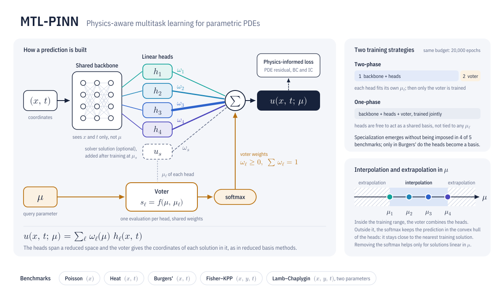

<h1 align="center">Physics-aware Multitask Learning\for Parametric PDEs</h1>
<p align="center">
  <a href="logo.svg">
    
  </a>
</p>

Official PyTorch implementation of the multitask Physics-Informed Neural Network (MTL-PINN) in:

> **Physics-aware Multitask Learning for Solving Parametric Partial Differential Equations**  
> Jon Ander Rivera, Javier Del Ser

A shared backbone reads only the coordinates \((\mathbf{x}, t)\). One linear head is learned for each training parameter. A voter network, evaluated once per head on the pair \((\boldsymbol{\mu}, \boldsymbol{\mu}_\ell)\), mixes the heads. With a softmax, the prediction lies in the convex hull of the head outputs. Without it, the raw scores are the weights, so the prediction can be any point in their linear span.

| PDE | Equation | Parameter | Training values |
|-----|----------|-----------|-----------------|
| Poisson | \(-u_{xx}+2\lambda=0\), \(u=\lambda x^2\) | \(\lambda\) | \(\{0.5, 1.5, 2.5, 3.5\}\) |
| Heat | \(u_t=\rho\, u_{xx}\) | \(\rho\) | \(\{0.05, 0.1, 0.2, 0.3\}\) |
| Burgers | \(u_t+u u_x-\nu u_{xx}=0\) | \(\nu\) | \(\{0.005, 0.01, 0.02, 0.03\}\) |
| Fisher–KPP | \(u_t=\Delta u+r u(1-u)\), \(D=1\) | \(r\) | \(\{0.5, 1.0, 1.5, 2.0\}\) |
| Lamb–Chaplygin | 2-D Euler, stream function and vorticity | \((a, U)\) | corners of \([0.8,1.2]\times[0.5,1.0]\) |

## Model variants

Four MTL-PINN variants combine the two training strategies with the two voter normalizations.

- **Two-phase.** For 16,667 epochs the voter is frozen. Each epoch updates the shared backbone from the mean of the per-task losses, then updates each head on its own training parameter. For the remaining 3,333 epochs the backbone and the heads are frozen and only the voter is trained on the mixed prediction.
- **One-phase.** Backbone, heads, and voter are trained jointly for 20,000 epochs. Heads are not tied to a training solution.
- **Softmax / no softmax.** The same two schedules are run with softmax weights and with raw voter scores.

The baseline is a fully connected tanh PINN of the same depth as the backbone. Its input is the coordinates concatenated with the parameter, and its width is chosen so that the parameter count matches the MTL-PINN. It is trained for 20,000 epochs on the same tasks, collocation budget, and optimizer.

Hybrid models start from the trained two-phase softmax checkpoint and add one numerical solution as an extra head, either at the interpolation query or at the extrapolation query. The numerical field has no weights. It is stored on a grid and read by multilinear interpolation. The loss is the physics loss at the four training parameters plus a data term of weight \(\gamma_s=10\) at the numerical head. That data term is applied only while the voter is being updated. Four retraining modes are stored:

| Mode | What is trained |
|------|-----------------|
| `only-voter` | voter |
| `backbone-frozen-retrain-rest` | heads and voter |
| `one-phase` | backbone, heads, and voter |
| `two-phase` | heads, then voter |

## Architecture

| PDE | Backbone | Heads | Voter | Points per task and epoch | Parameters |
|-----|----------|-------|-------|---------------------------|------------|
| Poisson | 3 × 64 | 4, one field | 2 × 32 on \((\lambda,\lambda_\ell)\) | 300 | 9,893 |
| Heat | 5 × 128 | 4, one field | 2 × 64 | 700 | 71,365 |
| Burgers | 5 × 128 | 4, one field | 2 × 64 | 700 | 71,365 |
| Fisher–KPP | 5 × 128 | 4, one field | 2 × 64 | 800 | 71,493 |
| Lamb–Chaplygin | 5 × 128 | 4, \((\psi,\omega)\) | 2 × 64 on \((a,U,a_\ell,U_\ell)\) | 900 | 72,137 |

## Repository layout

```
├── mtl_final/                 # Models, PDEs, training, evaluation, FLOPs
├── scripts/                   # Experiment launchers and figure scripts
├── outputs/
│   ├── comparison/            # Seed-50 MTL variants and the matched PINN
│   ├── hybrid/                # Numerical-head retraining
│   └── generalization/        # MAE along the query parameter (curves.csv)
├── tests/
├── logo.svg
├── requirements.txt
└── README.md
```

Each run directory contains `model.pth`, `losses.csv`, `train_metrics.csv`, `evaluation.csv`, `voter_weights.csv`, and the predicted fields under `fields/`.

## Installation

```bash
git clone https://github.com/javierdelser/MTL-PINN.git
cd MTL-PINN

python -m venv .venv
source .venv/bin/activate

pip install -r requirements.txt
pip install -e .
```

Use a CUDA build of PyTorch for GPU training (`--device cuda`).

## Reproduce the stored runs

```bash
python -m mtl_final compare --epochs 20000 --seed 50 --device cuda
python -m mtl_final hybrid --epochs 20000 --seed 50 --device cuda
```

One configuration:

```bash
python -m mtl_final train --pde heat --mode two-phase --softmax --seed 50 --device cuda
python -m mtl_final train --pde burgers --mode one-phase --nosoftmax --seed 50 --device cuda
```

Smoke test, a few epochs on every PDE:

```bash
python -m mtl_final smoke --device cpu
```

## Figures

The figure scripts read the stored checkpoints and `outputs/generalization/curves.csv`. They do not retrain.

```bash
python scripts/plot_generalization.py
python scripts/make_paper_figures.py --all
python scripts/plot_phase_heads.py
python scripts/plot_hybrid_heads.py
python scripts/show_comparison.py
```

`make_paper_figures.py` writes the solution panels, generalization and hybrid curves, learned-head grids, query fields, and voter-weight bars to `outputs/paper_figures/`. A subset is `python scripts/make_paper_figures.py --fig f3 weights`.

## Citation

```bibtex
@article{rivera2026physicsawaremtl,
  title   = {Physics-aware Multitask Learning for Solving Parametric Partial Differential Equations},
  author  = {Rivera, Jon Ander and Del Ser, Javier},
  journal = {Computer Methods in Applied Mechanics and Engineering},
  year    = {2026},
  note    = {Under second review. Corresponding author: jonander.rivera@ehu.eus},
  keywords = {Multitask Learning, Physics-Informed Neural Networks, Parametric Partial Differential Equations}
}
```
